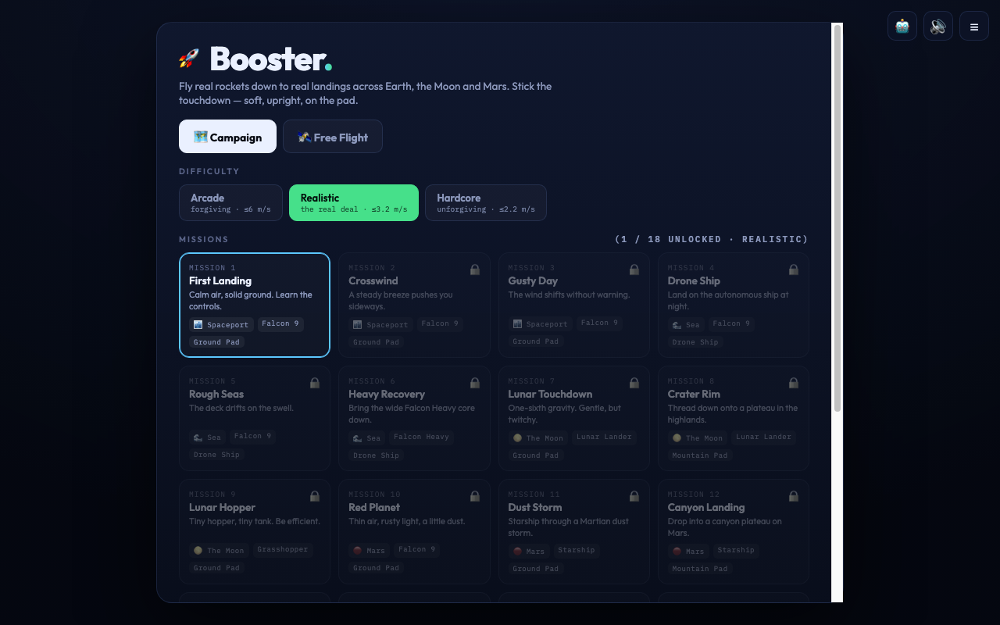

# Booster: rocket landing game

**▶ Try it online: [https://omri-n6gdp.github.io/rocket-landing/](https://omri-n6gdp.github.io/rocket-landing/)** (works on phones too)

Booster: rocket-landing game. 4 worlds (sea, spaceport, Moon, Mars), 5 rockets, an 18-mission campaign, weather hazards and a self-landing autopilot. Single HTML file, plays on phone too.

## How to play

- **On the Mac:** double-click **`index.html`**.
- **On your phone:** run `./phone.sh` on the Mac, then open `http://<your-mac-name>.local:8090` in Safari on the phone (same Wi-Fi).
- Press **H** in flight for the self-landing autopilot.

## Files

- `index.html`: the whole game
- `phone.sh`: serves the game to your phone over Wi-Fi
- `screenshots/`: screenshots of each world
- `docs/`: design spec and build plans
- `CLAUDE.md`: technical notes for Claude (architecture, test harness)
